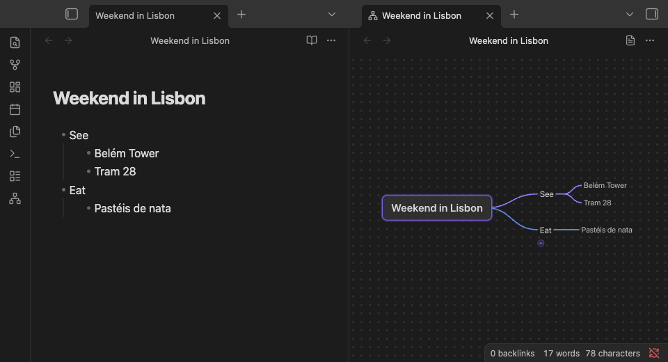
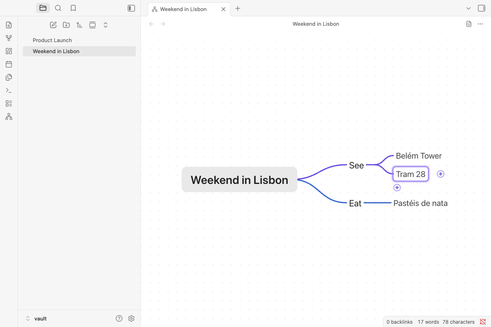
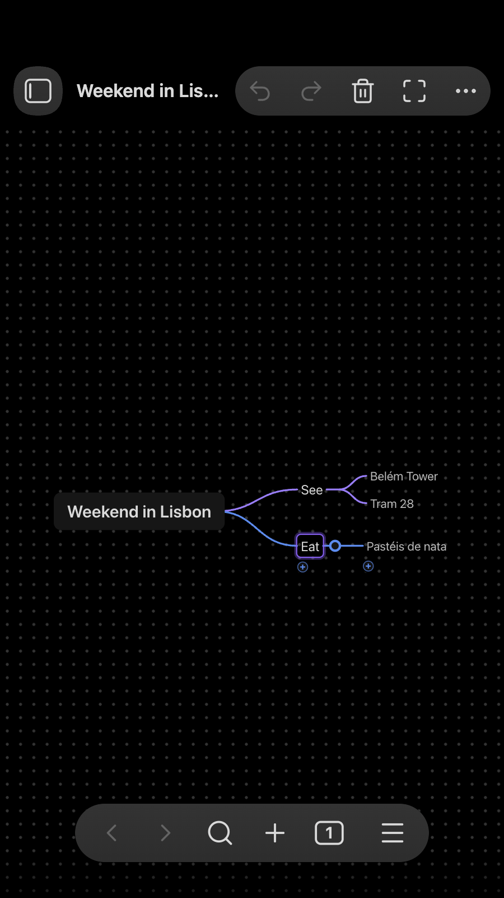

# Mindslate

**Edits touch only the lines you changed, so properties, links, comments and formatting in the note stay
byte-for-byte intact.**

Open a note as a keyboard-first mind map and edit it in place. The note stays an ordinary heading with a nested list.

<p align="center">
  
</p>

Mindslate draws a Markdown note as a mind map: the note's `# heading` is the root and its nested `- ` list is the
tree. You build and rearrange the map with the keyboard, the mouse or touch, and every change is a change to the note
itself. Obsidian saves it like any other note, and everywhere else (reading view, search, links, Obsidian Publish,
GitHub) it stays a plain outline.

## Features

- **Any note, as a map.** Open the note you are in as a map, in the same tab or beside its Markdown view, and switch
  back at any time.
- **Notes that always open as maps.** One property, `mindslate: map`, makes a note open as a map wherever Obsidian
  opens it: the file explorer, links, the quick switcher, search.
- **Keyboard first.** Tab adds a child, Enter a sibling, typing edits the selected node and Esc cancels. Arrow keys
  move around the map.
- **Mouse and touch too.** Click to select and click again to edit; drag a branch onto another node; the "+" buttons
  add a child or a sibling; a ring folds a branch and its count badge unfolds it; select several nodes to delete, move
  or fold them together; pan, zoom and pinch.
- **Your note stays your note.** An edit rewrites only the lines it touches: properties, text under items, links,
  tags and comments come back byte for byte, and opening a note as a map never changes it.
- **Saved the Obsidian way.** Obsidian saves the note 2 seconds after a change, when the tab closes and when you quit;
  Cmd/Ctrl+S saves at once.
- **Edits from elsewhere show up in place.** A change made in the Markdown view, by Obsidian Sync or on another device
  appears in the open map, with its folds, selection and zoom kept. Unsaved changes in the map are merged with it when
  they touch other lines; when both changed the same lines, nothing is lost: the map shows the note's new version and
  Undo brings yours back.
- **Each map as you left it.** Folded branches, the selected node and the zoom are kept for every note.
- **Your theme.** Light or dark, with your accent colour, also when you switch.
- **Phones and tablets.** Undo, Redo, Delete and Fit in the view's header, and large touch targets.
- **Maps from your AI agent.** An agent skill teaches Claude, or another agent, to write notes that open as maps
  ([For AI agents](#for-ai-agents)).

<p align="center">
  
  
</p>

## How it compares

Several Obsidian plugins open a Markdown note as a mind map you can edit. The table sets out what each one says about
itself on its page in the [community directory](https://community.obsidian.md/plugins) (read on November 1, 2026);
"—" means the page doesn't say.

| | Map is built from | Edit on the map | What a save writes | Folds are kept in | Desktop and mobile |
| --- | --- | --- | --- | --- | --- |
| **Mindslate** | The note's `# heading` and the nested list under it | Yes | Only the lines an edit touches; opening a note never writes it | The plugin's data (`data.json`), or the note when it already uses `<!-- markmap: fold -->` | Yes |
| [Rich Mindmap](https://community.obsidian.md/plugins/rich-mindmap) | Headings and nested lists | Yes | Byte for byte, apart from five listed normalizations (such as CRLF to LF and a final newline) | The `mindmap-collapsed` property in the note | Yes |
| [linkmind](https://community.obsidian.md/plugins/linkmind) | Headings and bullet lists | Yes | Every edit, as plain Markdown | — | Yes |
| [OMM MindMap](https://community.obsidian.md/plugins/omm-mindmap) | A nested bullet list, one tree per top-level bullet | Yes | The outline as a bullet list, and its layouts in a `mindmap-layout` property; other properties are kept | — | Yes |
| [Stratify Mindmap](https://community.obsidian.md/plugins/stratify-mindmap) | Headings, lists or both (three modes), in notes with `type: mindmap` | Yes | Node edits; paragraphs, quotes, code blocks, tables and comments stay in the note | Emphasis around the node's text in the note (`# *Deferred*`) | Yes |

The others also do things Mindslate doesn't: Rich Mindmap adds priority, progress and flag marks to nodes; linkmind,
OMM MindMap and Stratify Mindmap export a map as an image; Stratify Mindmap embeds a map in another note.

## Getting started

### Open a note as a mind map

- **Command palette** (Cmd/Ctrl+P): **Mindslate: Open as mind map**, or **Open as mind map in a split** to keep the
  Markdown view beside it.
- **Right-click**: a note in the file explorer, or the note's text while you edit it (Live Preview or Source mode;
  reading view has no such menu), or open the tab's **⋯** menu, then **Open as mind map**.
- **Back to Markdown**: the page button in the map's header, **⋯ > Open as Markdown**, or the command
  **Mindslate: Open as Markdown**.
- **Always as a map**: the command **Mindslate: Always open this note as a mind map** (or **Always open as mind
  map** in the note's menu) adds `mindslate: map` to the note's properties and changes nothing else. Run it again to
  take the property out. In a tab where you choose **Open as Markdown**, that note stays Markdown.
- **New mind map**: right-click a folder in the file explorer (or the empty space below the files, for the vault's
  top folder) and choose **New mind map** to make the map in that folder. The command and the map button in the
  ribbon make it where Obsidian puts new notes. The map opens with its root ready to type, and the note takes its name
  from the root.
- **Fit the map to the view** is a command too; give it a hotkey in **Settings > Hotkeys** if you like.

### Keys

| Key | What it does |
| --- | --- |
| Tab | Add a child |
| Enter | Add a sibling below; while typing, finish the node and start the next sibling |
| Typing, Space or F2 | Edit the selected node (typing replaces its text; Space and F2 keep it) |
| Esc | Cancel the edit (a new, empty node goes away) |
| Arrow keys | Parent, child, previous and next sibling |
| Shift+Tab | Select the parent |
| Delete or Backspace | Delete the node and its branch |
| Alt+Up / Alt+Down | Move the node among its siblings |
| Cmd/Ctrl+/ | Fold or unfold |
| Cmd/Ctrl+D | Duplicate the branch |
| Cmd/Ctrl+Z, Shift+Cmd/Ctrl+Z | Undo, redo |
| Cmd/Ctrl+C, X, V | Copy, cut and paste branches as Markdown lists |
| Cmd/Ctrl+A | Select every node |
| Cmd/Ctrl+= / - / 0 | Zoom in, out, to 100% |
| Cmd/Ctrl+S | Save now |

Obsidian's own shortcuts keep working while a map has the keyboard: Cmd/Ctrl+P, Cmd/Ctrl+O, Cmd/Ctrl+N, Cmd/Ctrl+W
and Cmd/Ctrl+1 to 9. A right-click on a node shows its actions.

### What a map looks like as a note

```markdown
---
mindslate: map
---
# Weekend in Lisbon

- See
	- Belém Tower
	- Tram 28
- Eat
	- Pastéis de nata
```

The `# heading` is the root (a note without one shows its file name instead) and each list item is a node, nested by
tabs. Other lists (`*`, `+`, numbers, spaces) open too, and text under an item stays with it.

More maps to open are in [`examples/`](examples): study notes on sharding (114 nodes), a trip plan, a project plan
and meeting notes. Copy the folder into your vault; each note opens as a map.

## For AI agents

The agent skill in [`skills/markdown-mind-map`](skills/markdown-mind-map) teaches an AI agent (Claude Code, the Claude
apps, or any agent that reads instructions) to make mind maps in your vault: how to plan a good map, the writing and
escaping rules, and how to add to a map without breaking it. Its command-line tool is built from Mindslate's own
Markdown reader and writer, so a map it writes is byte for byte what the plugin writes, and its validator prints the
tree the map will show. In a vault where Mindslate is installed, the agent gives each new map the `mindslate: map`
property, so with the plugin turned on the note opens as a map when you click it (if the plugin is off, the agent
tells you to turn it on).

Install it in Claude Code by copying the folder into your skills folder, then start a new session:

```
git clone --depth 1 https://github.com/wilsonneto-swe/mindslate-obsidian.git
mkdir -p ~/.claude/skills && cp -R mindslate-obsidian/skills/markdown-mind-map ~/.claude/skills/
```

Then ask, for example: "Make a mind map for our team offsite (venue, agenda, budget) in my Obsidian vault." For the
Claude apps and other agents, and more example prompts, see [skills/README.md](skills/README.md). The skill is not
part of the plugin: Obsidian never loads it, and the plugin's releases do not include it.

## Installation

- **From Community plugins**: Settings > Community plugins > Browse, search for "Mindslate", then select
  **Install** and **Enable**. Or select **Add to Obsidian** on
  [its page in the community directory](https://community.obsidian.md/plugins/mindslate).
- **Manually**: download `main.js`, `manifest.json` and `styles.css` from the
  [latest release](https://github.com/wilsonneto-swe/mindslate-obsidian/releases/latest) into
  `<vault>/.obsidian/plugins/mindslate/`, reload Obsidian, then enable **Mindslate** in Settings > Community
  plugins.
- **On your phone**: install it from Community plugins there too, or let Obsidian Sync bring it (turn on
  "Installed community plugins" and "Active community plugin list" in Settings > Sync on both devices).

Mindslate needs Obsidian 1.7.4 or later and runs on desktop (macOS, Windows, Linux) and mobile (iOS, iPadOS,
Android). It has been tested with Obsidian 1.13.7 and 1.14.5 on macOS and in Obsidian's mobile emulation, and with
1.7.4 on macOS.

## Privacy

Mindslate works offline. It makes no network requests, has no telemetry or ads, and needs no account. It reads and
writes only the notes you open as maps (and the notes its commands flag, create or rename), and keeps each map's
folds, selection and zoom in the plugin's own folder (`data.json`). It never reads or writes files outside your
vault.

## Building from source

```
npm install
npm run build      # main.js and styles.css, next to manifest.json
npm run dev        # the same, rebuilt on every change
npm run check      # Obsidian's lint rules, type checks, tests and the build
```

The plugin's code is in `src/`; `core/` is the Mindslate editor it bundles (the Markdown reader and writer, the
layout, the rendering and the keyboard and pointer input); `skills/` holds the agent skill, outside the build. Copy `main.js`, `manifest.json` and `styles.css` into
`<vault>/.obsidian/plugins/mindslate/`. Releases are built by GitHub Actions when a version tag is pushed
(`.github/workflows/release.yml`), with build attestations. [CONTRIBUTING.md](CONTRIBUTING.md) covers trying a
build in a test vault, reporting a bug and sending a pull request.

## Feedback

**What would make you switch from your current mind map plugin, or from the mind map app you use outside Obsidian?**
Tell us in [Discussions](https://github.com/wilsonneto-swe/mindslate-obsidian/discussions), where questions and ideas
are welcome too.

Found a bug? [Open an issue](https://github.com/wilsonneto-swe/mindslate-obsidian/issues/new/choose). The plugin is
developed together with its tests in a separate repository and exported here for each release, so a pull request is
welcome and ships with the next version: [CONTRIBUTING.md](CONTRIBUTING.md) explains how.

## License

MIT, see [LICENSE](LICENSE).

## More plugins by the author

[Plain Deck](https://community.obsidian.md/plugins/plain-deck): study flashcards written in your notes, with
spaced repetition (FSRS), and keep each card's progress in its own note, so it syncs with the vault.
